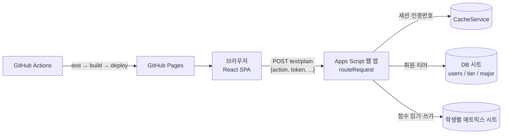

<br>

# Yutier: 유한대학교 TRUST 역량 관리·티어 서비스

유한대학교의 **YUHAN TRUST 역량 인증제**에서 학생이 받은 역량 점수를 관리하는 웹 서비스입니다. 점수에 따라 티어(Bronze, Silver, Gold, Diamond)를 매기고, 부족한 역량을 채울 수 있는 교내 프로그램을 추천합니다.
학교 TRUST 포털은 점수를 보여 주기만 하고, "내가 상위 몇 %인지"나 "무엇을 들으면 되는지"는 알려 주지 않습니다. 그 불편을 직접 풀어 보려고 만들었습니다.

[**🔗 서비스 바로가기**](https://youjiyeon12.github.io/Yutier/) · [**🎬 홍보 영상**](https://www.youtube.com/watch?v=-GCPQgqLkXE) · [**📄 배포 가이드 (PDF)**](https://youjiyeon12.github.io/Yutier/유티어(Yutier)%20프로젝트%20상세%20배포%20가이드.pdf)

| 구분 | 내용 |
|---|---|
| 기간 | 2025 (졸업 작품, YUHAN TRUST 프로그램), 2026.11 리팩터링·QA |
| 인원 | 5명 (팀 햄부기) |
| 프론트엔드 | React 19, Vite 7, React Router 7 (HashRouter), CSS Modules |
| 백엔드 | Google Apps Script (웹 앱) |
| DB | Google Sheets |
| 배포·CI | GitHub Pages, GitHub Actions (테스트 → 빌드 → 배포) |
| 테스트 | Vitest |

<br>

## 화면

| 메인 | 마이페이지 |
|---|---|
|  |  |
| **매트릭스(점수 입력)** | **YUHAN TRUST 안내** |
|  |  |

<br>

## 주요 기능

- **회원 관리**: 회원가입(아이디·학번 중복 확인), 로그인, 이메일 인증번호로 아이디·비밀번호 찾기, 정보 수정, 탈퇴.
- **역량 매트릭스**: 학생이 복사한 Google Sheet를 연결해서 학기별 프로그램 이수 여부와 점수를 입력·저장합니다.
- **자동 티어 산정**: 5개 핵심역량이 모두 70점 이상인 학생을 대상으로 상위 5%는 Diamond, 10%는 Gold, 30%는 Silver, 나머지는 Bronze를 매깁니다. 다음 티어까지 필요한 점수도 계산합니다.
- **프로그램 추천**: 총점이 가장 낮은 역량에서 2개, 나머지 역량에서 1개씩, 1회 점수가 높은 순으로 추천합니다.

<br>

## 아키텍처



- **API**: 모든 호출은 `src/services/googleSheetsService.js`의 `callAppsScriptAPI(action, data)`를 거칩니다. `Content-Type: text/plain`으로 보내서 Apps Script에서 CORS preflight가 생기지 않게 했습니다.
- **인증**: 로그인하면 서버가 UUID 토큰을 발급해서 `CacheService`에 6시간 저장합니다. 보호된 액션은 `routeRequest`에서 토큰으로 사용자 id를 찾아 핸들러에 넘깁니다. 클라이언트가 보낸 id는 믿지 않습니다. 세션이 없으면 `AUTH_REQUIRED`를 돌려주고, 프론트는 로그인 화면으로 보냅니다.
- **비밀번호**: PBKDF2-HMAC-SHA256(사용자별 salt). 예전 형식으로 저장된 해시는 로그인에 성공할 때 새 형식으로 다시 저장합니다.
- **비밀번호 재설정**: 이메일 인증번호(3분, 5회 틀리면 폐기)를 확인하면 일회용 재설정 토큰(10분)을 받고, 그 토큰이 있어야 비밀번호를 바꿀 수 있습니다.

<br>

## 리팩터링과 QA (2026.11)

졸업 작품을 QA 없이 배포했었기 때문에, 포트폴리오로 쓰기 전에 직접 QA를 하고 나온 문제를 고쳤습니다.

| 분류 | 문제 | 해결 |
|---|---|---|
| 🔴 보안 | 비밀번호 재설정과 정보 수정 API가 **아이디만 받으면 동작**해서 남의 비밀번호를 바꿀 수 있었음 | 세션 토큰 인증 도입, 재설정은 인증번호 확인 후 받은 일회용 토큰으로만 가능하게 함 |
| 🔴 보안 | 매트릭스·티어 API가 아이디만으로 남의 데이터를 읽고 쓸 수 있었음 | 보호된 액션 표(`PROTECTED_HANDLERS`)에서 일괄 검사, id는 세션에서만 꺼냄 |
| 🟠 보안 | 비밀번호가 GET 쿼리스트링으로 전송되고 배포 사이트 콘솔에 출력됨 | POST로 전환하고 개인정보 로그를 전부 제거 |
| 🟠 보안 | 인증번호 무차별 대입 가능, 아이디 찾기와 비밀번호 찾기가 같은 캐시 키를 씀 | 5회 시도 제한, 키를 `idcode:`/`pwcode:`로 분리 |
| 🟠 보안 | SHA-256 1회 해시, 일부 계정은 평문 저장 | PBKDF2로 전환하고 로그인할 때 자동으로 다시 저장. 평문 계정은 재설정으로 유도 |
| 🟠 버그 | `/mypage`, `/detail`에서 새로고침하면 404 (`history.replaceState`가 해시 경로를 지움) | 해당 코드 제거, 없는 경로는 홈으로 이동 |
| 🟠 버그 | 매트릭스 학기 탭이 없으면 다른 학기를 보여 주는데 저장은 원래 학기로 시도해서 실패 | 서버가 실제로 읽은 탭 이름을 돌려주고, 화면을 그 학기로 맞춤 |
| 🟡 UX | 회원가입 등에서 처리 중인지 알 수 없고 버튼을 여러 번 누를 수 있음 | 모든 비동기 버튼에 처리 중 문구, `disabled`, `aria-busy` 적용 |
| 🟡 UX | 375px에서 1180px까지 가로 스크롤(헤더 `min-width: 1000px` 등) | 375~1920px 전 페이지 가로 넘침 제거. 넓은 화면 디자인은 그대로 두고 좁은 화면용 미디어 쿼리만 추가(수정 전후 스크린샷을 픽셀 단위로 비교해 확인) |
| 🟡 접근성 | 입력칸에 이름이 없고 Enter로 제출할 수 없음 | `aria-label`·`autocomplete` 추가, `form` 제출, 실패한 칸으로 포커스 이동 |
| 🟡 운영 | 시트 ID가 코드에, 서버 URL이 저장소의 `.env`에 있음 | 시트 ID는 Apps Script 스크립트 속성으로, URL은 GitHub Actions 변수로 옮김 |
| 🟡 품질 | 테스트 없음, lint 에러 10개, npm 취약점 20개 | Vitest 15개(PBKDF2를 Node 표준 구현과 비교, 토큰·재설정·시도 제한 검증), CI에서 테스트 통과해야 배포, lint 0, 취약점 0 |

<br>

## 시작하기

### 1. 백엔드 (Google Apps Script)

1. 두 시트의 사본을 만듭니다.
   - [DB 템플릿 사본 만들기](https://docs.google.com/spreadsheets/d/1pZEerJseEaWSAbWqdZeWqg93kwY7IBdYZwLhBJTrCGc/copy): 회원·티어 데이터가 쌓이는 시트입니다. **공유 설정은 "제한됨"으로 둡니다.**
   - [매트릭스 템플릿 사본 만들기](https://docs.google.com/spreadsheets/d/12ymRONolKRri2KKSiVT6SCHxJarmTsS9ZqZ-_0LYt6s/copy): 학생 각자가 복사해서 쓰는 점수 입력 양식입니다.
2. [Apps Script](https://script.google.com)에서 새 프로젝트를 만들고 `apps_script/backend.gs` 내용을 붙여넣습니다.
3. **프로젝트 설정 → 스크립트 속성**에 `SPREADSHEET_ID` = DB 시트 ID를 추가합니다.
4. **배포 → 새 배포 → 웹 앱**을 고르고, 실행 사용자는 "나", 액세스 권한은 "모든 사용자"로 배포한 뒤 웹 앱 URL을 복사합니다.
   - 코드를 고친 뒤에는 "새 배포"가 아니라 **배포 관리 → 수정 → 새 버전**으로 배포해야 URL이 유지됩니다.

### 2. 프론트엔드

```bash
git clone https://github.com/youjiyeon12/Yutier.git
cd Yutier
npm install
cp .env.example .env          # VITE_APPS_SCRIPT_URL에 웹 앱 URL 입력
npm run dev                   # http://localhost:5173/Yutier/
```

| 명령 | 설명 |
|---|---|
| `npm run dev` | 개발 서버 |
| `npm test` | Vitest (백엔드 `backend.gs`는 Node에서 Apps Script 전역 객체를 흉내 내서 실행) |
| `npm run lint` | ESLint |
| `npm run build` | 프로덕션 빌드 (`dist/`) |

### 3. 배포 (GitHub Pages)

저장소 **Settings → Secrets and variables → Actions → Variables**에 `VITE_APPS_SCRIPT_URL`을 등록하면, `main`에 push할 때마다 테스트 → 빌드 → 배포가 자동으로 실행됩니다.

<br>

## 폴더 구조

```
apps_script/
  backend.gs          # Apps Script 백엔드 (라우팅, 인증, 시트 읽기·쓰기, 티어·추천 계산)
  backend.test.js     # backend.gs 단위 테스트
src/
  services/           # googleSheetsService: API 호출, 토큰 첨부, 세션 만료 처리
  pages/              # auth / home / matrix / mypage
  components/         # Header, Footer, 추천 목록
.github/workflows/    # test → build → GitHub Pages 배포
```

<br>

## 한계와 다음 과제

- **Apps Script 제약**: 웹 앱은 HTTP 상태 코드를 바꿀 수 없어서 응답 본문의 `success`/`code`로 결과를 구분합니다. 실행 시간 제한 때문에 PBKDF2 반복 횟수를 2,000회로 낮게 잡았습니다. 횟수는 해시마다 저장되므로 나중에 올려도 기존 계정이 깨지지 않습니다.
- **시트 기반 DB**: 동시에 여러 명이 쓰는 경우를 고려한 잠금(`LockService`)과 인덱스가 없어서, 사용자가 많아지면 RDB로 옮겨야 합니다.
- **커밋 기록**: 예전 커밋에는 운영 URL과 시트 ID가 남아 있습니다. 그래서 DB 시트 공유를 "제한됨"으로 두는 것을 보안의 전제로 삼았습니다.
- **큰 컴포넌트**: `Matrix.jsx`(약 800줄)는 테이블·필터·도움말 모달을 나눌 여지가 있습니다.

<br>

## 팀 햄부기
<table>
  <tbody>
    <tr>
      <td align="center">
        <a href="https://github.com/kikikim29">
          
          <br />
          <span style="font-size:18px;"><b>김려원</b></span>
        </a>
        <br />
      </td>
      <td align="center">
        <a href="https://github.com/svrain">
          
          <br />
          <span style="font-size:18px;"><b>김은비</b></span>
        </a>
        <br />
      </td>
      <td align="center">
        <a href="https://github.com/youjiyeon12">
          
          <br />
          <span style="font-size:18px;"><b>김원정(팀장)</b></span>
        </a>
        <br />
      </td>
      <td align="center">
        <a href="https://github.com/HBAKM">
          
          <br />
          <span style="font-size:18px;"><b>박한별</b></span>
        </a>
        <br />
      </td>
      <td align="center">
        <a href="https://github.com/narae04">
          
          <br />
          <span style="font-size:18px;"><b>윤나래</b></span>
        </a>
        <br />
      </td>
    </tr>
  </tbody>
</table>

<br>

## 도움을 주신 분들

- **티어 이미지 디자인**: 숙명여자대학교 환경디자인과 박령빈
- **백엔드 마이그레이션 (Node.js → Google Apps Script)**: 유한대학교 컴퓨터공학과 김형균, 용지순

---
*This project was part of the YUHAN TRUST program.*
